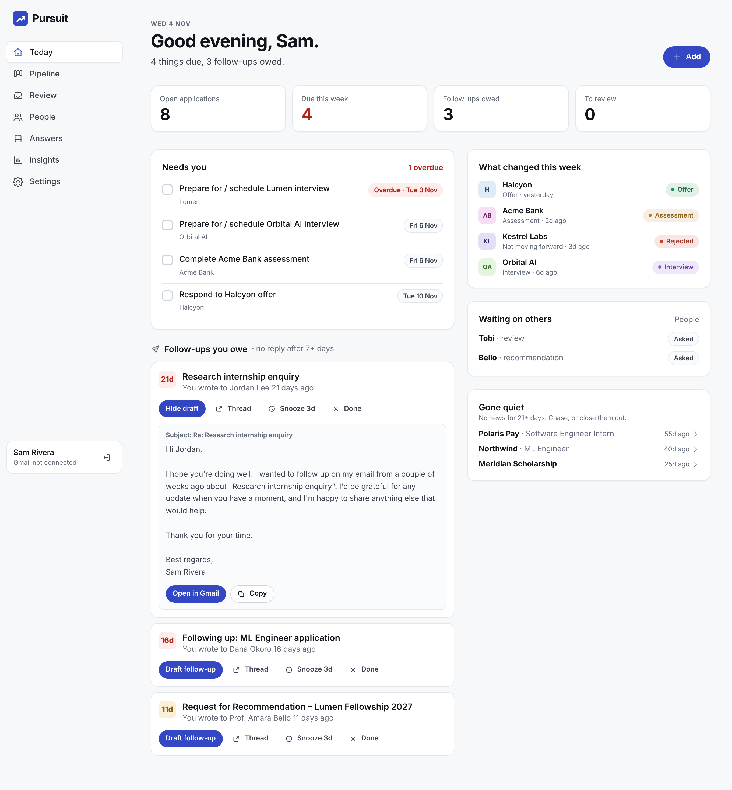
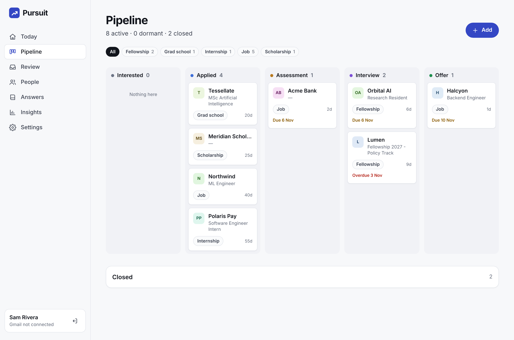
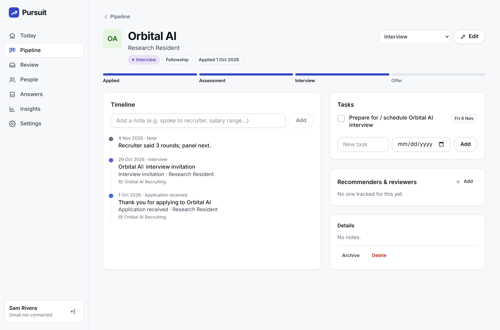
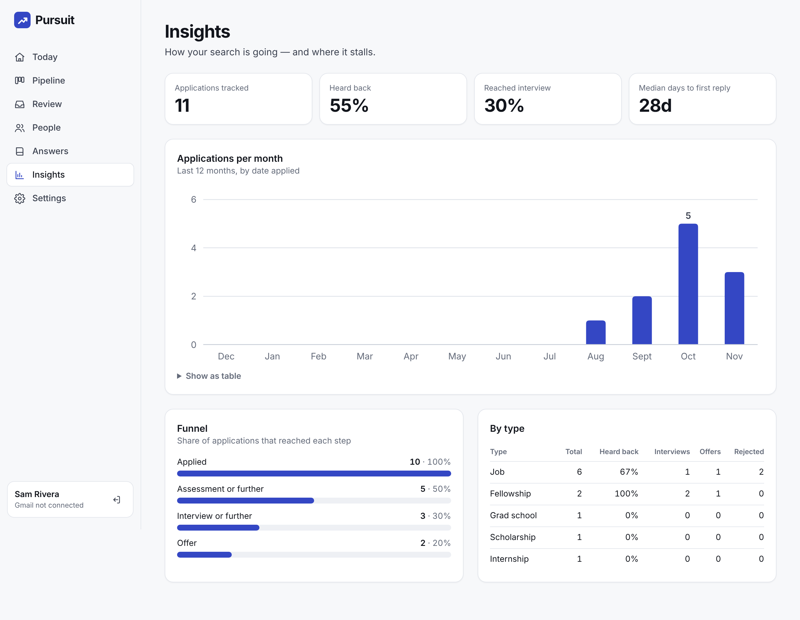

# Pursuit

**Every application, deadline and follow-up, tracked for you.** Pursuit reads your application email (Gmail read-only, forwarding, or import) and keeps your whole pipeline of jobs, internships, fellowships, grad school, scholarships and research positions in one place.



- **Builds itself from email.** Confirmations, assessments, interviews, offers and rejections from Greenhouse, Lever, Workday, Oracle HCM, HackerRank, Hireflix, university admissions and direct recruiter mail become opportunities with a stage and a timeline.
- **Deadlines pulled from the email.** "Complete the video interview by Tuesday" and "within 5 days" become dated tasks. Tasks close themselves when a later email shows they're done (assessment submitted, you replied to the offer).
- **Follow-ups you owe.** Threads where you wrote last to a real person and nobody replied after N days, with a polite draft ready to open in Gmail.
- **Recommenders & reviewers.** Emails asking for a letter or a draft review are tracked automatically per application: asked, then agreed, then submitted.
- **Answer bank.** Reusable paragraphs (bio, research pitch, "why us") with one-click copy.
- **Insights.** Applications per month, the funnel, response rate by type, and median days to first reply.
- **Human in the loop.** Uncertain emails wait in **Review**, every stage change links to the email that caused it, and manual edits are never overwritten.
- **Private.** Gmail scope is read-only and tokens are encrypted at rest. Pursuit never sends email. Export or delete everything at any time.

Docs: [Product requirements](docs/PRD.md) · [Design](docs/DESIGN.md)

| Pipeline | Opportunity | Insights |
|---|---|---|
|  |  |  |

---

## How it understands email

It works **without an AI key**. A rule engine, tuned against real hiring-platform templates, detects:
- **stage:** received → assessment → interview → offer, or rejection;
- **organisation:** the real company, not the hiring platform: "Goldman Sachs Hiring Team" via HackerRank → Goldman Sachs; "ERA via Hireflix" → ERA;
- **role, type and deadlines:** for example "within 5 days", or "by November 10";
- **outbound asks:** "Request for Recommendation – …", "… Draft Review".

44 unit tests cover it, including regressions found by backfilling a real inbox: accented names (CaCTüS), "applying to X" versus roles, application cycles by year, and a person's name versus the company.

With `ANTHROPIC_API_KEY` set, Claude refines anything the rules found plausible, using structured output (with refusal fallbacks enabled). Obvious noise never reaches the model, and email content is always treated as data, never as instructions.

Matching is by Gmail thread first, then by normalised organisation plus role similarity. Stages only move forward, except for final outcomes.

## Quick start (local)

```bash
npm install
cp .env.example .env.local      # set APP_SECRET; Gmail and AI are optional
npm run dev                     # http://localhost:3000
```

Try it without Gmail: sign up, then import the fictional demo data from **Settings → Import**.

```bash
node scripts/demo-data.mjs > demo.json
```

## Connect Gmail (read-only)

1. In Google Cloud Console, create a project and **enable the Gmail API**.
2. **OAuth consent screen:** External; add the scope `.../auth/gmail.readonly`; add yourself (and any testers) as **test users**. Testing mode allows up to 100 users with no Google review.
3. **Credentials:** create an OAuth client ID (Web application) with the authorised redirect URI `<APP_URL>/api/google/callback`.
4. Set `GOOGLE_CLIENT_ID`, `GOOGLE_CLIENT_SECRET` and `APP_SECRET`, then click **Connect Gmail** in Settings.

The first sync backfills `BACKFILL_DAYS` (default 180). After that, Pursuit syncs incrementally every 15 minutes through Gmail's history API. It stores only application email, replies in those threads, and your sent mail (needed to know who owes you an answer).

> Opening Pursuit to the public with Gmail requires Google's restricted-scope verification (a CASA security assessment). Until then, use testing mode or the forwarding address, which needs no Google approval.

## Deploy

Pursuit is a single Node process with SQLite, so any host with a persistent disk works.

**Render.** Choose **New → Blueprint**, pick this repo, and fill in `APP_URL`. `render.yaml` provisions the service, a 1 GB disk and the secrets.

**Fly.io:**
```bash
fly launch --copy-config --no-deploy
```
```bash
fly volumes create pursuit_data --size 1
```
```bash
fly secrets set APP_URL=https://<app>.fly.dev APP_SECRET=$(openssl rand -hex 24) GOOGLE_CLIENT_ID=... GOOGLE_CLIENT_SECRET=...
```
```bash
fly deploy
```

**Docker (any VPS):**
```bash
cp .env.example .env && docker compose up -d --build
```

**Forwarding (optional).** Point an inbound email provider (e.g. Postmark Inbound) at `<APP_URL>/api/inbound/postmark?secret=<INBOUND_SECRET>` and set `INBOUND_DOMAIN`. Each user gets a private address. Manually forwarded `Fwd:` emails are unwrapped to their original sender.

**Morning brief (optional).** Set `SMTP_URL` and `MAIL_FROM`.

## Development

```bash
npm test            # 44 unit + integration tests (classifier, ingestion, follow-ups, insights)
npm run typecheck && npm run lint
npm run build && npm start
INBOUND_SECRET=testsecret node scripts/e2e.mjs   # 30-step browser test against a running server
```

```
src/lib/classify/   rules.ts (offline classifier) · claude.ts (optional) · index.ts
src/lib/ingest.ts   store → classify → match/create opportunity → events, tasks, asks, auto-complete
src/lib/gmail.ts    OAuth, backfill, incremental history sync, encrypted tokens
src/lib/followups.ts  follow-ups owed + drafts
src/lib/data.ts     Today, pipeline, people, insights queries
src/app/app/        Today · Pipeline · Opportunity · Review · People · Answers · Insights · Settings
```
