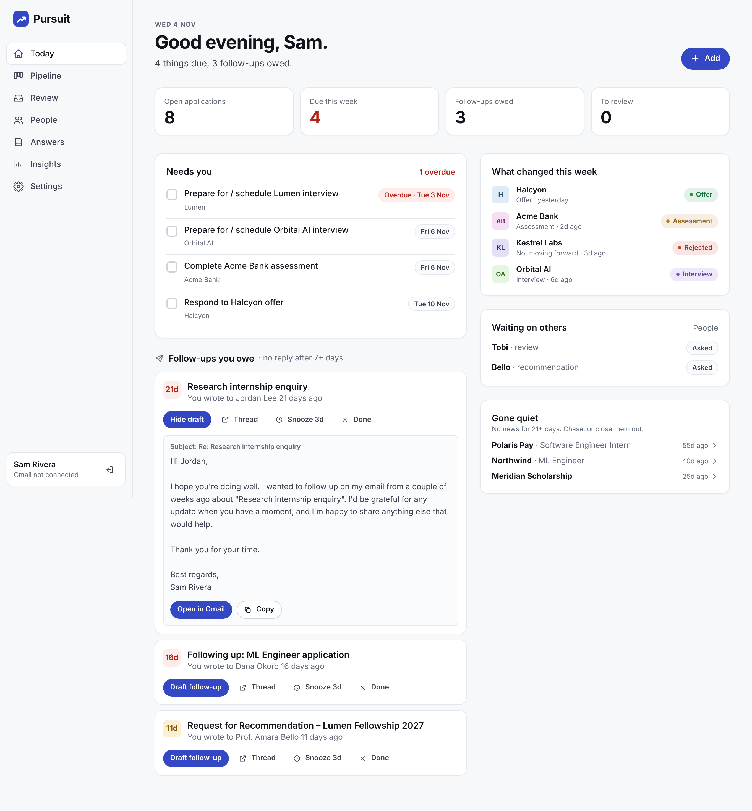
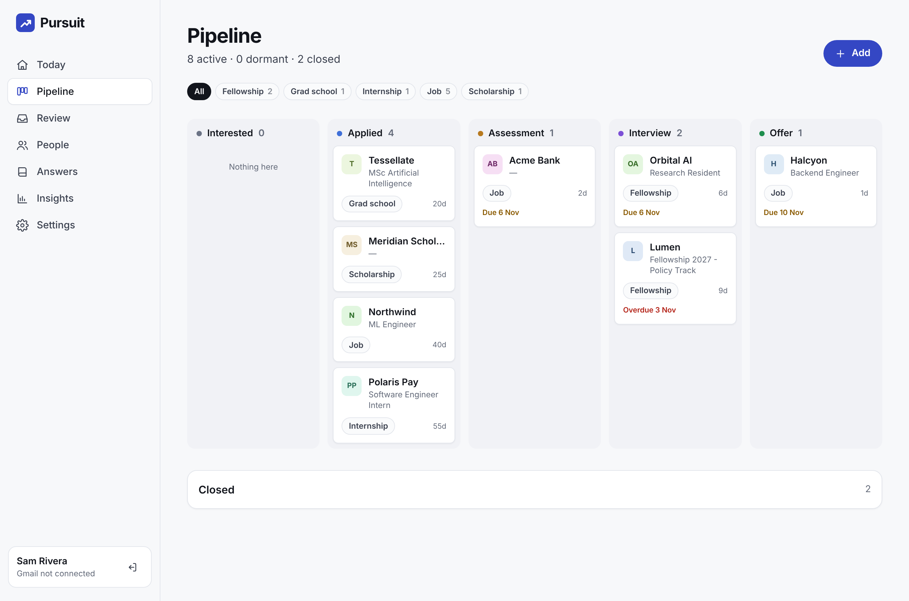
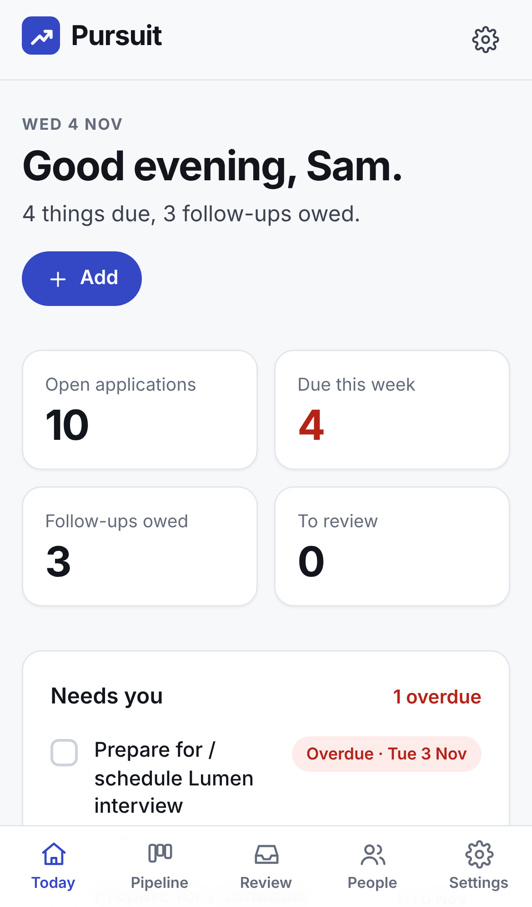
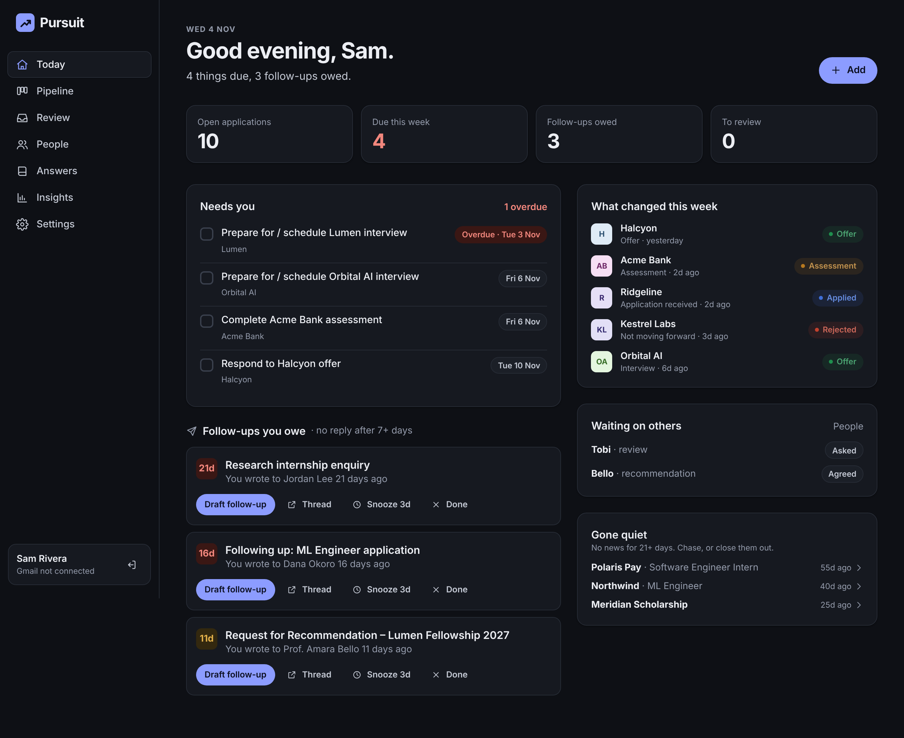

# Pursuit — Design

Pursuit is a work tool for a stressful season. It should feel **calm, dense and decisive**: the home screen is a to-do list, not a dashboard, and every number is one click from the email behind it.

| Today | Pipeline | Mobile | Dark |
|---|---|---|---|
|  |  |  |  |

## Principles

1. **Today first.** Sections run in the order you act on them: *Needs you* (dated tasks, overdue in red), then *Follow-ups you owe*, then *What changed*, *Waiting on others* and *Gone quiet*.
2. **Show the source.** Every timeline event carries the email subject, the sender and an "Open in Gmail" link.
3. **Never silently wrong.** Uncertain mail goes to Review; manual stage changes are sticky; nothing is deleted without a confirm.
4. **One accent.** Indigo marks actions and the current position. Stage colours are used only on stage badges and columns, always with their label.

## Tokens (`src/app/globals.css`)

| Token | Light | Dark |
|---|---|---|
| `--bg` / `--surface` | `#F7F8FA` / `#FFFFFF` | `#0E1015` / `#161920` |
| `--ink` / `--ink-2` / `--muted` | `#12151C` / `#3C4250` / `#646B7A` | `#ECEEF3` / `#C4C9D4` / `#949BAB` |
| `--line` / `--line-strong` | `#E3E6EC` / `#CDD2DB` | `#272C36` / `#3A404D` |
| `--accent` | `#3447C4` | `#8C9CFF` |
| Danger / honey / sage | reused from the shared token set for overdue, waiting and done | |

Contrast (WCAG AA, checked): accent on white 7.4:1, muted on bg 5.0:1, dark accent on its ink 7.6:1, dark muted on bg 6.8:1, accent on accent-soft 6.2:1.

**Stage colours** (`components/badges.tsx`): interested `#6B7385`, applied `#3F6FD8`, assessment `#B7791F`, interview `#7C4FD6`, offer `#1F8F4E`, closed `#8A8F99`, rejected `#C2412D`. Badges tint the colour at 13% and darken the text toward ink, so they read in both themes.

**Organisation avatars:** initials on a hue derived from the organisation's name, so the same company always looks the same across views.

## Screens

| Screen | Job |
|---|---|
| Landing | One sentence and a live-looking Today preview |
| Today | What needs me now |
| Pipeline | Kanban by stage with type filters; *Dormant* (4+ months of silence) and *Closed* collapse below |
| Opportunity | Stage, progress bar, timeline with notes, tasks, recommenders, details |
| Review | Uncertain emails: track as new, attach to an existing opportunity, or dismiss |
| People | Recommenders and reviewers with ask status (asked, agreed, submitted) |
| Answers | Reusable paragraphs with tags, search and copy |
| Insights | Stat tiles, applications per month, funnel, outcomes by type |
| Settings | Gmail, forwarding, import, preferences, export and delete |

## Charts

Insights follows the shared data-viz method:
- **Monthly chart:** a single series, so no legend is needed. Columns are at most 24 px wide, with a 4 px rounded data end, a square baseline and hairline gridlines.
- **Labels:** only the peak month is labelled directly. Every column has a hover title, and a "Show as table" view gives the same data in text.
- **Funnel:** meters on a neutral track, each with its count and percentage written out.

## Accessibility
- Native `<dialog>` for every form; labelled controls; `aria-current` in navigation; `aria-label` on icon-only buttons.
- Colour is never the only signal: stages, overdue status and ask status all carry text.
- Mobile tab bar with safe-area padding. The pipeline scrolls horizontally inside its own container, never the page.
