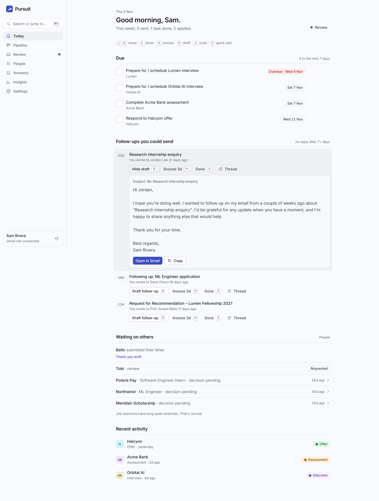
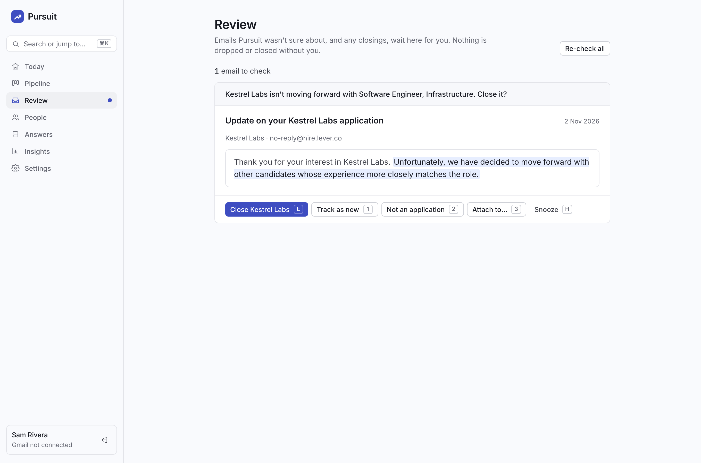
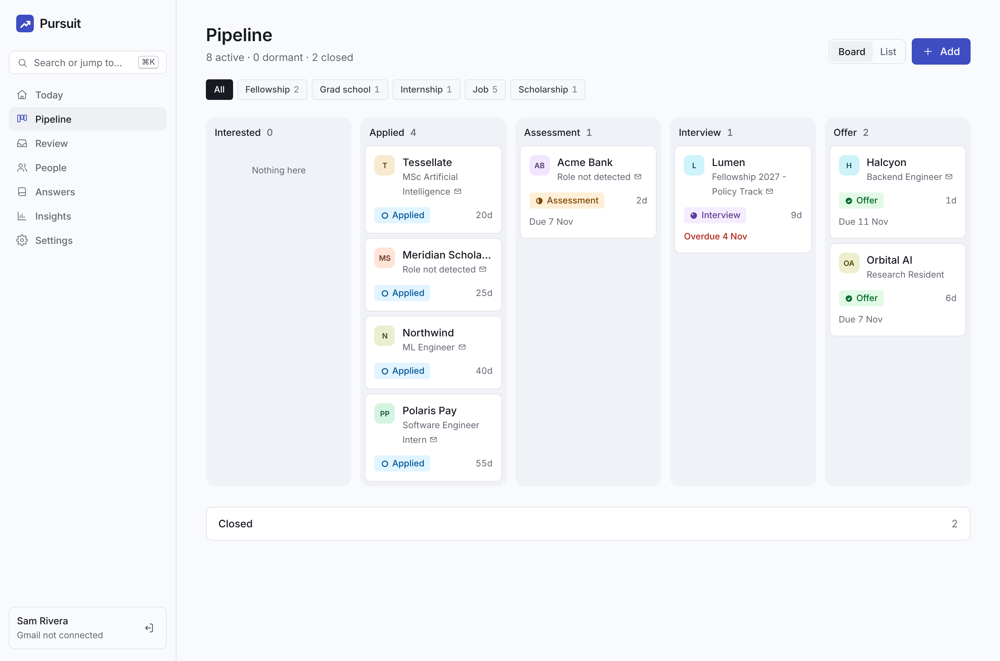
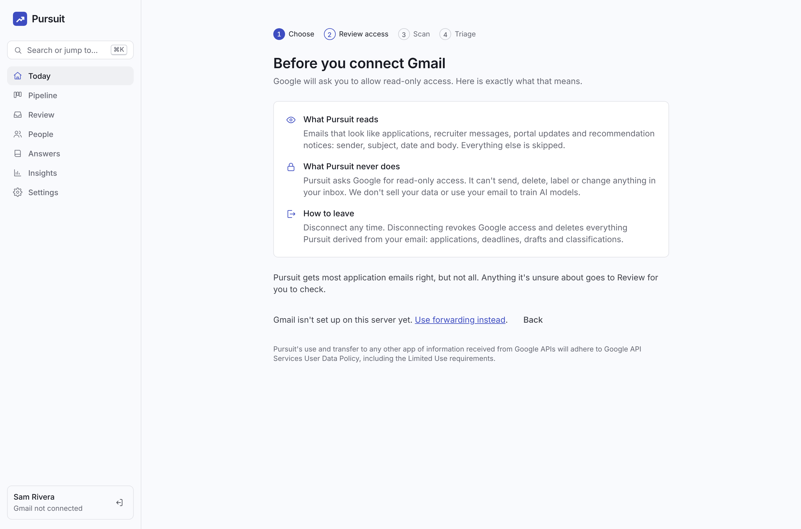
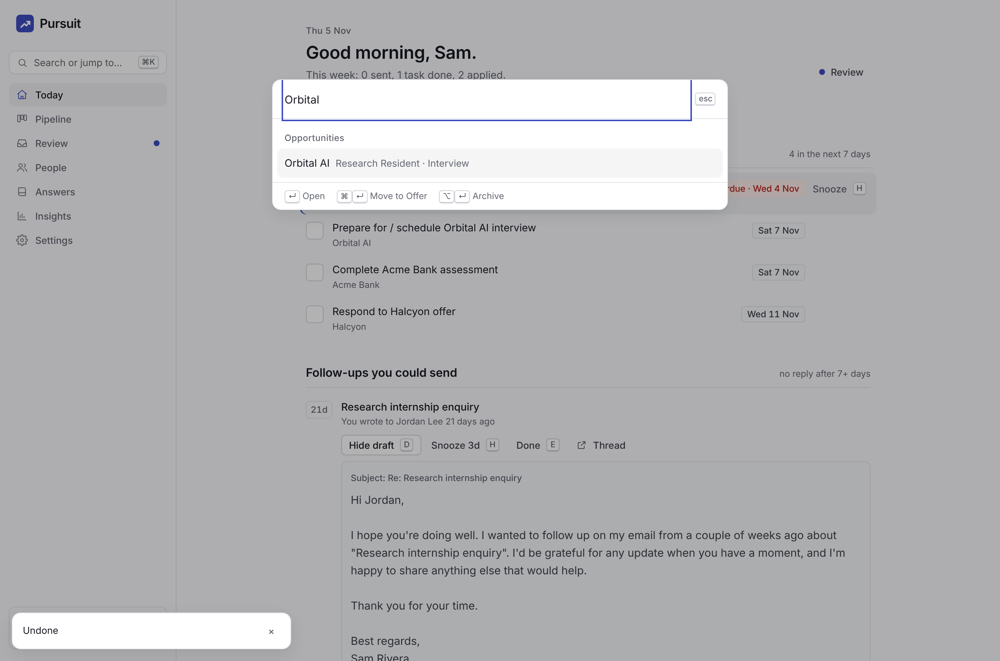
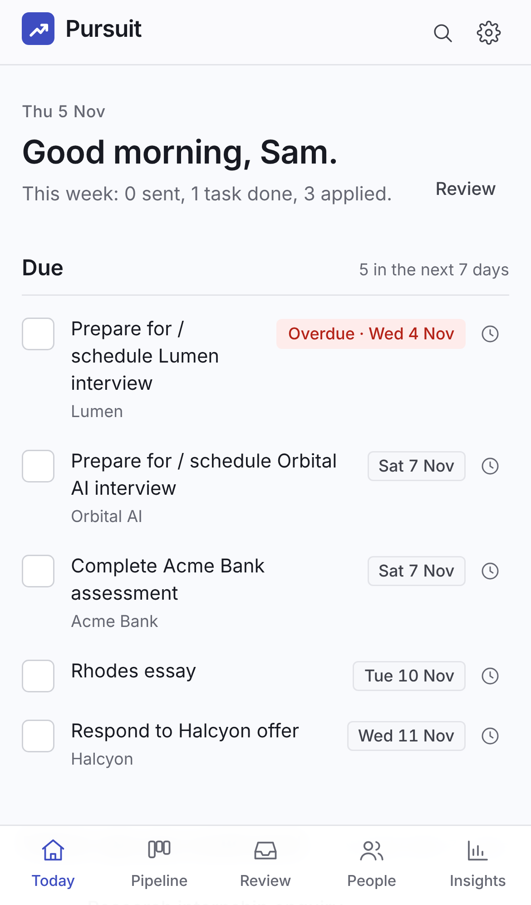
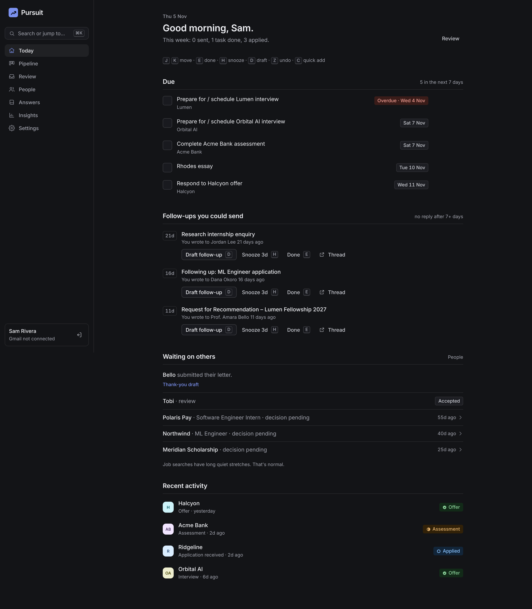

# Pursuit: Design

Pursuit is a work tool for a stressful season. It should feel **calm, keyboard-fast and trustworthy**. Home is a short, finite queue, not a dashboard. Every inferred fact shows the email sentence it came from, and every action can be undone.

The choices below come from a benchmark of Linear, Superhuman, Things, Raycast, Granola, Attio, Teal, Huntr, Simplify and TripIt, plus research on notification batching (Fitz/Kushlev), human–AI interaction (Microsoft HAX) and WCAG 2.2.

| Today | Review | Pipeline |
|---|---|---|
|  |  |  |

| Onboarding | Command palette | Mobile | Dark |
|---|---|---|---|
|  |  |  |  |

## Principles

1. **A finite queue, then done.** Today has three groups in the order you act on them: *Due*, *Follow-ups you could send*, *Waiting on others*. When they're empty, a calm "Done for today" state appears. There are no streaks and no KPI tiles; the header shows effort ("This week: 6 sent, 2 follow-ups done").
2. **Show the source, in words.** Timeline events quote the sentence that drove them ("Detected from email · 12 Oct · Open in Gmail"). Review explains uncertainty in a sentence ("Pursuit isn't sure whether this is an interview invite"), never as a percentage.
3. **Undo, not confirm.** Stage moves, archive, delete, review verdicts, snoozes and task completion apply immediately and show an Undo toast. Only *disconnect and delete* and *delete account* ask first, and the latter requires typing a phrase.
4. **Closings are calm.** Rejections show as **Closed** in gray and never notify you. A closing from the last 14 days waits in Review ("Kestrel Labs isn't moving forward with Software Engineer. Close it?"). Older ones from a backfill apply quietly. After a closing, at most two optional next steps appear, and both can be dismissed for good.
5. **Inferred until confirmed.** Role and type that Pursuit guessed show in secondary text with a small mail glyph until you confirm ("Looks right") or edit them. When you correct an organisation name, Pursuit offers a narrow rule, and "Just this once" is the default.
6. **One accent.** Indigo is for actions, focus and the current place only, never a status. Red is reserved for deadlines under 48 hours.

## Tokens (`src/app/globals.css`)

Neutrals are tinted OKLCH at hue 275. Cards use a border with no shadow; shadows appear only on floating layers (palette, menus, toasts, dialogs).

| Token | Light | Dark |
|---|---|---|
| `--bg` | `oklch(0.985 0.004 275)` | `oklch(0.19 0.008 275)` |
| `--surface` / `--surface-raised` | white / white + float shadow | `oklch(0.22 0.01 275)` / `oklch(0.25 0.01 275)` |
| `--line` | `oklch(0.92 0.007 275)` | white 10% |
| `--fill-hover` | black 4% | white 6% |
| `--ink` (text-1) | `oklch(0.22 0.016 275)` | `oklch(0.95 0.005 275)` |
| `--muted` (text-2: meta, inferred) | `oklch(0.52 0.017 275)` | `oklch(0.72 0.014 275)` |
| `--accent` | `oklch(0.48 0.18 272)` | `oklch(0.68 0.14 272)` |

**Status chips** pair a step-3 background with step-11 text at one hue, always with a label and a glyph. Applied uses blue `#E1F4FF / #00579A`, Assessment amber `#FFEFD8 / #7E4700`, Interview violet `#F5EDFF / #614092` and Offer green `#E2F9E6 / #00682A`. **Closed, Dormant and Withdrawn** share a neutral `#F0F1F8 / #525561`. Every pair has a dark variant.

**Type:** Inter Variable (`@fontsource-variable/inter`) with `cv11`, and tabular numerals on dates, counts and stats. The scale is 12 meta, 13 dense rows, 14 UI, 15–16 excerpts and drafts, 16/600 section titles, 24/600 page titles and 40–56 marketing only. Weights stop at 600 in the app.

**Radius:** 4 (chips) · 6 (buttons, inputs) · 8 (cards) · 12 (dialogs, palette).

**Motion:** `--dur-1` 120 ms (hover), `--dur-2` 180 ms (menus, toasts), `--dur-3` 240 ms (dialogs), `--ease-out` `cubic-bezier(0.23, 1, 0.32, 1)`. Only transform and opacity animate. Entrances scale from 0.95 and presses scale to 0.97. Under `prefers-reduced-motion`, all custom motion is removed.

**Icons:** a single outline set at a 1.5 px stroke. There are no sparkle icons for automation.

## Interaction

| Area | Keys |
|---|---|
| Anywhere | ⌘K / Ctrl+K palette · G then T/P/R/O/A/I/S to navigate · C quick add · / search opportunities · ? shortcut sheet · Z undo |
| Lists | J/K move · Enter open · E done · H snooze · D open draft · M move stage · ⌫ delete (with undo) · Esc clear |
| Review | E accept suggestion · 1 track as new · 2 not an application · 3 attach to existing (fuzzy picker) · H snooze |
| Palette | Enter primary · ⌘Enter secondary (for example, move to the next stage) · ⌥Enter tertiary (archive). Commands for the open item appear at the top |

**Toasts** sit bottom-left, outside the focused content and above the mobile tab bar. They use `aria-live="polite"`, last 6 s, pause on hover or focus and stack at most three.

**Quick add** takes one line with a natural date ("Rhodes essay due Nov 20"), or a pasted link, which becomes an *Interested* opportunity.

**Accessibility (WCAG 2.2):** every card has a "Move to…" menu as the alternative to dragging (2.5.7). Targets are at least 24 px (2.5.8). Every task has a date picker. Toasts never cover focus (2.4.11). Colour is never the only signal.

## Screens

| Screen | Job |
|---|---|
| Landing | Outcome headline, "Connect Gmail, read-only" and "See it with sample data", a hero loop of an email becoming a card, a four-step walkthrough, a privacy section with the Limited Use sentence, segments and an FAQ |
| Onboarding (`/app/connect`) | Choose a path (Gmail, forwarding, import, or a sample-data sandbox) → pre-OAuth explainer (*What Pursuit reads / never does / How to leave*) → live scan counts → first triage |
| Today | The finite queue, an Upcoming drawer and recent activity |
| Review | One email at a time with the evidence highlighted, keyed verdicts and "Accept all routine confirmations" |
| Pipeline | Board or list (list by default on mobile), a Move to… menu on every card, inferred fields muted, Dormant and Closed collapsed, and "Mark stale as dormant" (60+ days, undoable) |
| Opportunity | Stage provenance, a quoted timeline, confirm or edit inferred fields, next action, recommenders with nudge drafts, archive/delete with undo |
| People | A roster across all applications ranked by recency and frequency, portal vocabulary (requested → accepted → submitted), "owes N letters, M due this week", nudge and thank-you drafts |
| Insights | Effort first (emails sent per week, applications started, follow-ups, tasks), the weekly receipt and answer reuse; outcomes sit behind a click |
| Settings | Gmail plus trust copy, notifications (cadence, hour, real-time, pause for a week), forwarding, import, rules (ignore sender or domain, organisation aliases), preferences and data |

## Notifications

| Event | Channel |
|---|---|
| Digest (due, replies, interviews, follow-ups you could send, letters submitted; weekly receipt on Mondays) | Email at your hour, daily, weekdays or weekly |
| Interview invitation · deadline under 48 h | Real-time email, once per item |
| Forwarded email parsed | Receipt email |
| Closing detected | None (Review only) |
| Review items waiting | A dot on the nav, no count |
| Pause for 7 days | Settings and ⌘K |
